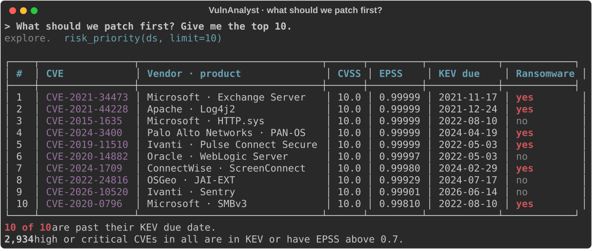
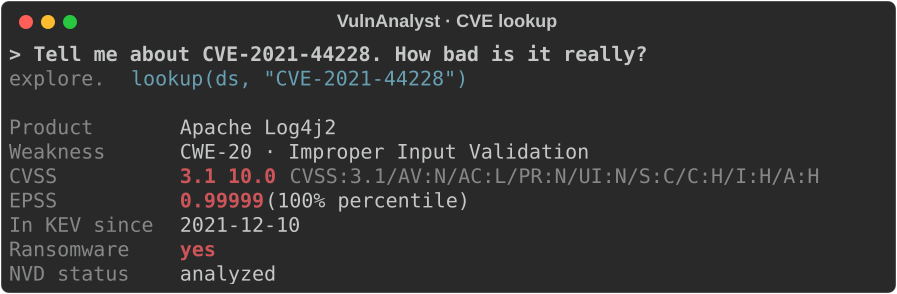
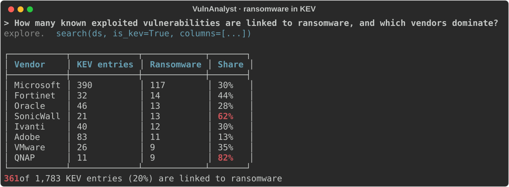
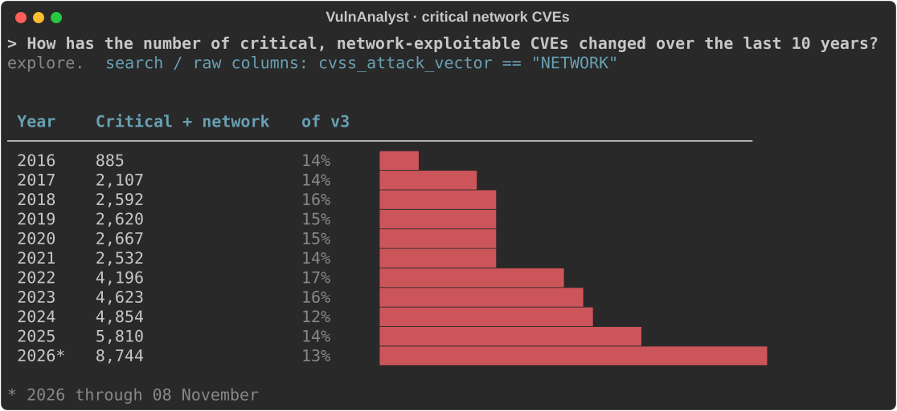

<h1 align="center">VulnAnalyst</h1>

<p align="center">
  <b>A Claude skill that answers vulnerability questions like an analyst. It builds a local NVD library with vulnflow, queries it, and combines CVSS severity, EPSS likelihood and CISA KEV exploitation into one answer.</b>
</p>

<p align="center">
  
  
  <a href="https://github.com/corifeo/VulnFlow"></a>
  
</p>

<p align="center">
  <a href="#installation">Install</a> ·
  <a href="#examples">Examples</a> ·
  <a href="#how-it-works">How it works</a> ·
  <a href="#contents">Contents</a> ·
  <a href="#development">Development</a>
</p>

<p align="center">
  
</p>

Ask "what should we patch first?", "which vendors had the most critical CVEs in 2025?" or "what is CVE-2021-44228?". VulnAnalyst answers from data, not from memory:

- **Local and complete.** It checks for an NVD library, builds or refreshes one if needed (all 433,000 CVEs in about two minutes), and queries it in place.
- **Risk, not just severity.** Every answer weighs CVSS against EPSS and KEV, and says when data is partial: unanalyzed CVEs, missing CPEs, the current year in progress.
- **Checkable.** It answers through vulnflow's `explore` helpers, so every figure traces back to one Python call you can rerun.

## Installation

Run Claude from a project that uses [uv](https://docs.astral.sh/uv/) and has vulnflow installed:

```bash
uv add git+https://github.com/corifeo/vulnflow
```

Then install the skill. Claude Code, for all projects:

```bash
git clone https://github.com/corifeo/VulnAnalyst ~/.claude/skills/vulnanalyst
```

For one project only, clone into `.claude/skills/vulnanalyst` inside that project instead.

The library is written to `data/complete_library.parquet` in the project root. The first build downloads every NVD yearly feed.

## Examples

Each screenshot shows the question, the `explore` call the skill makes for it, and the result on a full NVD build (433,329 CVEs, 8 November 2026). The quoted answers are condensed from a fresh Claude Code session with only this skill installed.

**"Tell me about CVE-2021-44228. How bad is it really?"**

<p align="center">
  
</p>

> CVSS 3.1 10.0, EPSS 0.99999, in KEV since 2021-12-10, used by ransomware. The 10.0 is earned. Today's risk is leftover copies in vendor appliances and old Java services.

**"How many known exploited vulnerabilities are linked to ransomware, and which vendors dominate?"**

<p align="center">
  
</p>

> 361 of 1,783 KEV entries (20%). Microsoft leads with 117. By share, QNAP (82% of its KEV entries) and SonicWall (62%) are the most ransomware-prone.

**"How has the number of critical, network-exploitable CVEs changed over the last 10 years?"**

<p align="center">
  
</p>

> CVSS v3 critical plus network rose from 2,107 (2017) to 5,993 (2025), with 9,333 in 2026 through November. The share stays at 12–18% of v3-scored CVEs, so the growth tracks overall CVE volume.

**"Which vendors had the most critical CVEs published in 2025?"**

> 6,651 critical CVEs. The top of the list is bulk-reported PHP projects and routers: phpgurukul 319, campcodes 243, fabian 172, code-projects 134, dlink 105. Among major vendors, Apple has 95 and Microsoft 54. About 26% have no CPE vendor yet.

## How it works

| Step | What the skill does |
|------|---------------------|
| 1. Check data | `data_info()`: build, refresh or reuse `data/complete_library.parquet`, depending on its age and the question's scope |
| 2. Query | `explore` helpers with `fmt="json"`: `risk_priority`, `exploitation`, `vendor_risk`, `lookup`, `search`, … |
| 3. Interpret | Combine CVSS, EPSS and KEV, caveat partial data, and summarize instead of dumping rows |

## Contents

| File | Purpose |
|------|---------|
| [`SKILL.md`](SKILL.md) | Workflow: check data, query with `vulnflow.helpers.explore`, interpret |
| [`references/domain.md`](references/domain.md) | CVSS, EPSS, KEV, SSVC, CVD model, prioritization |
| [`references/recipes.md`](references/recipes.md) | Build, query, export and pipeline code patterns |

## Development

Regenerate the screenshots from a project with vulnflow and a built library:

```bash
uv run --with rich python path/to/VulnAnalyst/.github/scripts/make_readme_assets.py
```

## Related

[vulnflow](https://github.com/corifeo/VulnFlow) is the data pipeline this skill drives. [VulnState](https://github.com/corifeo/VulnState) models a single CVE's disclosure lifecycle as a state machine.

## Data sources and notices

The skill ships no data. vulnflow downloads it at run time from its publishers, and each source's terms apply; see the [vulnflow README](https://github.com/corifeo/VulnFlow#data-sources-and-notices).

## License

[MIT](LICENSE)
